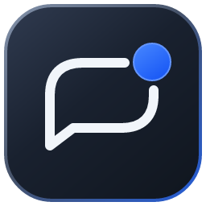
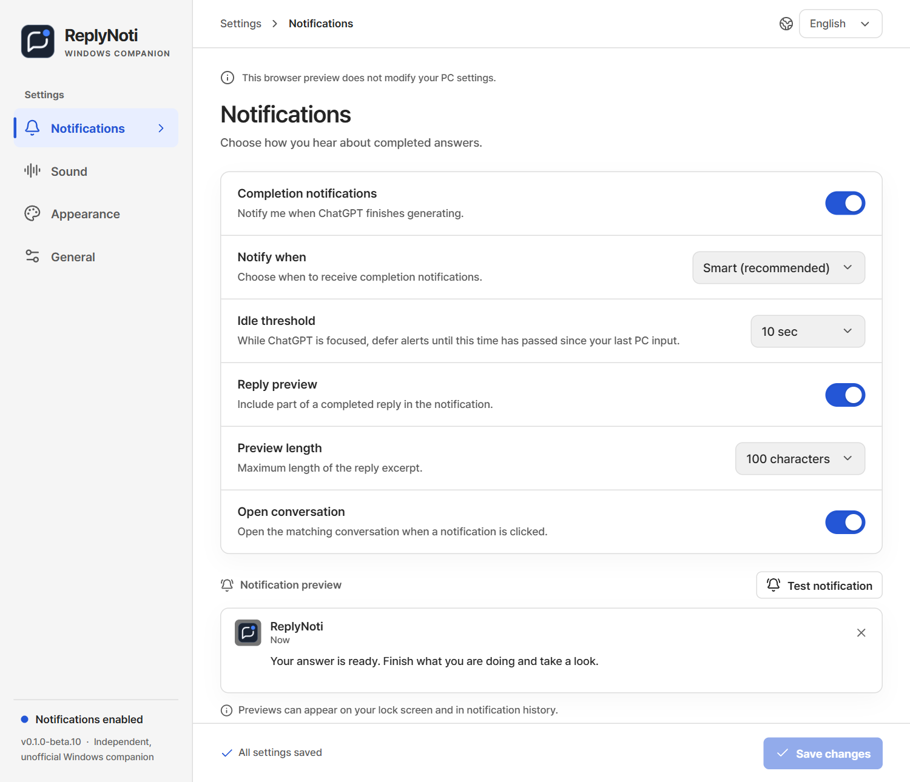

<p align="center"></p>
<h1 align="center">ReplyNoti</h1>
<p align="center"><strong>답변이 준비되면 알려드립니다.</strong><br>ChatGPT Chat 응답 생성이 끝나면 Windows 알림을 보내는 작은 유틸리티입니다.</p>
<p align="center"><a href="README.en.md">English</a> · 한국어</p>
<p align="center">
<a href="https://github.com/1wxxk/replynoti-for-chatgpt/actions/workflows/ci.yml"></a>


<a href="LICENSE"></a>
</p>

ChatGPT Chat에 질문한 뒤 답변이 끝날 때까지 기다릴 필요 없습니다. 다른 작업을 하다가 알림이 오면 확인하세요. 별도 계정, API 키, 브라우저 확장 프로그램이 필요하지 않습니다.

> **비공식 실험적 베타입니다.** OpenAI와 제휴하거나 지원받는 공식 제품이 아닙니다. 기존 ChatGPT 앱을 대체하지 않으며, 감지가 항상 정확한 것은 아닙니다.

## 다운로드

[**Windows 설치형 EXE (권장)**](https://github.com/1wxxk/replynoti-for-chatgpt/releases/download/v0.1.0-beta.8/ReplyNoti-Setup-x64.exe) · [포터블 ZIP](https://github.com/1wxxk/replynoti-for-chatgpt/releases/download/v0.1.0-beta.8/ReplyNoti-Portable-x64.zip) · [릴리스 노트](https://github.com/1wxxk/replynoti-for-chatgpt/releases/tag/v0.1.0-beta.8)

Windows 11 x64용 비공식 베타입니다. 코드 서명되지 않았으므로 Windows 보안 경고가 나타나거나 실행이 차단될 수 있습니다. [SHA-256](https://github.com/1wxxk/replynoti-for-chatgpt/releases/download/v0.1.0-beta.8/SHA256SUMS.txt)으로 무결성을 확인하고 시스템 보안 정책을 준수하세요. 일반 사용자는 Rust나 Node.js 설치가 필요 없습니다.

## 화면 미리보기

<p align="center"></p>

<p align="center"></p>

설정창 내장 데모 데이터를 사용한 화면입니다.

## 빠른 시작

**필요 환경:** Windows 11 x64, 설치된 ChatGPT 데스크톱 앱(통합 OpenAI.Codex 패키지의 Chat 모드), 최신 설정창용 WebView2.

1. 위 설치형 EXE를 다운로드하고 실행합니다. 자동 시작 여부를 선택할 수 있습니다.
2. 포터블 ZIP을 선택했다면 전체 압축을 푼 뒤 Start-Portable.exe를 실행합니다.
3. ChatGPT 데스크톱 앱에서 질문을 보냅니다.
4. 답변이 생성되는 동안 다른 작업을 합니다.
5. 생성 종료로 판단되면 Windows 알림이 표시됩니다.

작업 표시줄 알림 영역의 ReplyNoti 아이콘을 우클릭해 **테스트 알림**을 실행하세요. 아이콘을 더블 클릭하면 설정창이 열립니다.

### 포터블 사용법

앱 파일과 설정은 압축을 푼 폴더에 유지합니다. Windows 알림, 시작 메뉴, 대화 이동에 필요한 사용자별 등록은 수행합니다. 폴더를 옮기거나 삭제하기 전 Unregister-Portable.exe를 실행하세요. 설치형과 포터블은 동시에 등록할 수 없습니다. WebView2가 없다면 [공식 Microsoft 페이지](https://developer.microsoft.com/microsoft-edge/webview2/)에서 설치하세요.

## 주요 기능

| 기능 | 설명 |
| --- | --- |
| 응답 완료 알림 | 추적 중인 답변의 완료 표시가 확인되면 Windows 알림 표시 |
| 스마트 알림 | 기본값: 백그라운드에서는 즉시 알림, 활성 창에서는 마지막 PC 입력 이후 10초까지 보류 |
| 응답 미리보기 | 50, 100, 150 UTF-16 단위 중 선택, 기본 활성화 |
| 알림 클릭 | 안전하게 식별할 수 있는 경우 원래 대화로 이동 |
| 알림음 | Windows 기본음, 사용자 지정 WAV, 무음 |
| 개인화 | 표시 이름과 PNG/ICO 아이콘 변경 |
| 설정창 | 한국어·영어·시스템 언어, 라이트·다크·시스템 테마 |
| 시스템 트레이 | 빠른 설정, 테스트 알림, 종료 |
| 자동 시작 | Windows 로그인 시 실행 여부 선택 |
| 로컬 처리 | API 키나 원격 전송 없이 Rust 감지 엔진이 독립적으로 실행 |

## 설정 사용법

트레이 아이콘을 더블 클릭하거나 시작 메뉴에서 ReplyNoti를 실행하세요.

- **알림:** 완료 알림, 응답 미리보기, 길이, 클릭 동작을 설정합니다.
- **알림음:** 기본음, 무음, 사용자 지정 WAV를 선택합니다. 지원되는 설치 앱에 포함된 알려진 완료음을 로컬로 가져올 수도 있습니다.
- **외관:** 표시 이름, 아이콘, 테마를 변경합니다. 기본 아이콘으로 복원할 수 있습니다.
- **일반:** 한국어·영어·시스템 언어와 Windows 자동 시작을 설정합니다.

변경 후 **변경사항 저장**을 누르세요. 사용 권한이 있는 리소스만 가져오세요. 공식 앱의 아이콘이나 알림음은 제품에 포함해 배포하지 않습니다.

### 알림 조건

- **스마트 알림(기본값):** ChatGPT 창이 비활성화되어 있으면 즉시 알립니다. 활성 창이라면 마지막 PC 입력 이후 선택한 시간(10초, 30초, 1분, 3분)이 지나거나 다른 창으로 전환할 때까지 완료 알림을 보류합니다. 새 응답 생성, 대화 전환 또는 5분 경과 시 보류된 알림은 폐기합니다.
- **항상 알림:** 창 활성화 여부와 관계없이 완료 알림을 보냅니다.
- **백그라운드에서만:** 해당 ChatGPT 창이 활성화된 경우 알림을 생략합니다.

Windows의 마지막 입력 시각만 로컬에서 확인하며 입력한 글자나 마우스 좌표는 수집하지 않습니다. 테스트 알림은 알림 조건을 적용하지 않습니다. 입력이 없다고 실제 자리를 비웠다는 뜻은 아닙니다.

## 호환성 및 문제 해결

| 문제 | 확인할 사항 |
| --- | --- |
| 알림이 오지 않음 | Windows 설정 → 시스템 → 알림에서 ReplyNoti 알림 허용 후 테스트 알림 실행 |
| 소리가 나지 않음 | 알림음 설정 및 방해 금지 확인. 사용자 지정 WAV는 시스템 무음 정책과 다를 수 있음 |
| 알림 누락 또는 중복 | Chat 모드에서 일반 응답으로 재현하고 OS·앱 버전과 함께 제보 |
| 알림 클릭 시 이동하지 않음 | 대화 식별 실패, 작성 중인 초안, 생성 중에는 이동하지 않음 |
| 설정창이 열리지 않음 | WebView2와 별도 설정창 실행 파일 확인 |

Windows 11 x64의 일반적인 콘솔 세션, 알려진 한국어·영어 접근성 UI를 대상으로 개발했습니다. 현재 한국어 Windows 개발 PC에서 테스트했으며 다른 PC와 영어 감지는 추가 검증이 필요합니다. 웹, Classic, Codex, Work 모드는 지원하지 않습니다. 짧은 응답, 창 최소화, 취소, 앱 업데이트 등에 따라 누락이나 오탐이 발생할 수 있습니다. [호환성 및 테스트](docs/COMPATIBILITY.md)를 참고하세요.

## 개인정보 보호

공식 완료 API 대신 Windows 접근성 UI 상태를 관찰합니다. 별도 로그인이나 텔레메트리, 네트워크 호출은 없습니다. 미리보기는 로컬에서 처리하고 앱 로그에 기록하거나 외부로 전송하지 않습니다. 다만 Windows 알림 기록과 잠금 화면에 내용이 남을 수 있습니다. 민감 정보 필터는 완벽하지 않으므로 민감한 대화나 자동 추출이 허용되지 않는 환경에서는 미리보기를 끄세요. 끄더라도 이전 알림은 삭제되지 않습니다.

자세한 내용은 [개인정보 보호 정책](docs/PRIVACY.md)을 참고하세요.

## 소스에서 빌드

Windows 11 x64, Rust stable(MSVC), Visual Studio C++ Build Tools, Windows SDK, Node.js 22 이상, WebView2가 필요합니다. PowerShell에서 실행하세요.

```powershell
git clone https://github.com/1wxxk/replynoti-for-chatgpt.git
cd replynoti
cargo test --release --locked
cargo build --release --locked
cd settings-ui
npm ci
npm run build
cd src-tauri
cargo build --release --locked
cd ../..
.\Install.ps1
```

설치 옵션: `-AutoStart`는 로그인 시 자동 시작, `-NoPreview`는 미리보기 기본 비활성화, `-NoStart`는 설치 후 실행하지 않기입니다. 일반적으로 관리자 권한이 필요하지 않습니다. 서명되지 않은 베타이므로 스크립트를 검토하고 Windows 보안 정책을 준수하세요.

## 삭제

보존할 사용자 지정 아이콘과 알림음은 먼저 백업하세요.

```powershell
& "$env:LOCALAPPDATA\ReplyNoti\Uninstall.ps1"
```

삭제 스크립트는 관리 대상 파일, 설정, 가져온 리소스, 자동 실행 등록, 프로토콜 처리기를 제거합니다. 공식 ChatGPT 앱은 변경하지 않습니다. 이전 Windows 알림 기록은 남을 수 있습니다. 설치형 업데이트는 새 Setup EXE를 실행하면 기존 설정과 사용자 지정 아이콘·알림음을 보존합니다. Windows 설정 → 앱 → 설치된 앱에서 ReplyNoti를 삭제할 수 있습니다. 포터블은 Unregister-Portable.exe로 등록을 해제한 뒤 폴더를 삭제하세요.

## 기여 및 버그 제보

[Issues](https://github.com/1wxxk/replynoti-for-chatgpt/issues)에 Windows 빌드, ChatGPT 앱 버전, UI 언어, 재현 순서와 예상·실제 동작을 남겨주세요. 대화 내용이나 확인하지 않은 로그는 첨부하지 마세요.

## 라이선스

[MIT](LICENSE). [서드파티 라이선스](THIRD_PARTY_NOTICES.txt)를 참고하세요. ChatGPT는 OpenAI의 상표이며 이 프로젝트는 독립적으로 개발됩니다.
