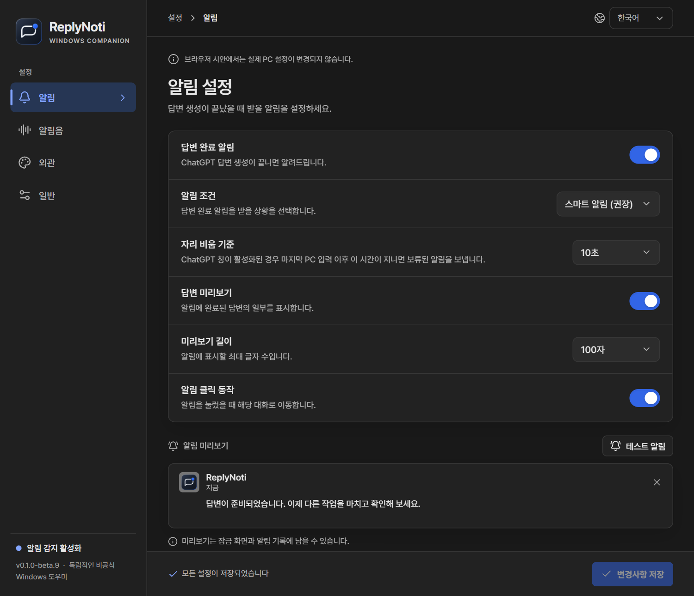

<p align="center"></p>
<h1 align="center">ReplyNoti</h1>
<p align="center"><strong>Your reply is ready.</strong><br>Get a Windows notification when ChatGPT Chat stops generating.</p>
<p align="center">English · <a href="README.ko.md">한국어</a></p>
<p align="center">
<a href="https://github.com/1wxxk/replynoti/actions/workflows/ci.yml"></a>


<a href="LICENSE"></a>
</p>

Start a reply, switch to another task, and let ReplyNoti tell you when generation appears to end. No API key, extra account, or browser extension required.

> **Unofficial, experimental beta.** Not affiliated with or endorsed by OpenAI. ReplyNoti is a separate Windows utility, not a replacement ChatGPT client. Detection is best effort.

## Preview

<p align="center"></p>

<p align="center"></p>

Screenshots use the settings UI's built-in demo data.

## Quick start

**Requirements:** Windows 11 x64, the installed ChatGPT desktop app (unified OpenAI.Codex package, Chat mode), and WebView2 for the modern settings window.

1. Build the app using [Build from source](#build-from-source). This is a source-first beta; a downloadable installer is not yet published.
2. Review the install scripts, then run `Install.cmd` or `.\Install.ps1` in PowerShell.
3. Open ChatGPT desktop and send a message.
4. Switch to another app. ReplyNoti watches for the end of generation and displays a Windows notification.
5. Right-click the tray icon and choose **Test notification** to check sound and notifications, or double-click it to open Settings.

## Features

| Feature | Description |
| --- | --- |
| Completion notifications | Native Windows toast after the tracked reply's completion indicators are confirmed |
| Smart notifications | Default: notify immediately in the background, or defer while ChatGPT is focused until 10 seconds since the last PC input |
| Reply preview | Optional 50, 100 or 150 UTF-16 units; on by default |
| Click to open | Return to the original conversation when it can be safely identified |
| Notification sound | Windows default, custom WAV, or silent |
| Personalization | Custom display name and PNG/ICO icon |
| Settings | English, Korean or system language; light, dark or system theme |
| System tray | Quick controls, test notification, exit |
| Startup | Optional launch at Windows sign-in |
| Local-first | No telemetry or API keys; Rust watcher runs independently of the settings window |

## Settings

Double-click the tray icon or open ReplyNoti from Start.

- **Notifications:** enable alerts, toggle the reply preview, choose its length and click behavior.
- **Sound:** select Windows default, silent or a custom WAV. A known bundled completion sound can be imported from a supported locally installed app.
- **Appearance:** change the display name, icon and theme. Restore the default icon anytime.
- **General:** choose English, Korean or system language, and start at sign-in.

Select **Save changes** to apply preferences. Only import assets you have permission to use. Official app assets are not distributed with ReplyNoti.

### Notification timing

- **Smart (default):** send when the ChatGPT window is in the background, or when it is focused and the PC has been idle for the chosen threshold (10, 30, 60 or 180 seconds). A verified completion is held until eligible; a new generation, conversation change or five-minute expiry discards the held alert.
- **Always:** send verified completions regardless of focus.
- **Background only:** skip alerts when the corresponding ChatGPT window is focused.

Idle time is measured locally using Windows' last-input timestamp; no keystrokes, mouse coordinates or input text are recorded. Test notifications bypass the timing rule. A lack of input may also mean the user is reading, not away.

## Compatibility and troubleshooting

| Issue | What to check |
| --- | --- |
| No toast | Windows Settings → System → Notifications; verify notifications are enabled for ReplyNoti, then use Test notification |
| No sound | Check sound settings and Windows Do Not Disturb; custom WAV may bypass system quiet-hours behavior |
| Reply missed or duplicate | Try an ordinary reply in Chat mode; report OS/app version and reproduction steps |
| Click does not open the chat | Navigation is skipped if the conversation cannot be uniquely matched, a draft exists, or generation is active |
| Settings does not open | Ensure WebView2 and the separate settings executable are available |

Target: Windows 11 x64, interactive console session, known Korean and English accessibility labels. The development host is a Korean-language Windows 11 PC; independent PCs and English detection still need validation. Browser ChatGPT, Classic, Codex and Work modes are not supported. UI changes, short replies, minimized windows and cancellation can cause missed or false alerts. See [compatibility and testing](docs/COMPATIBILITY.md).

## Privacy

ReplyNoti observes local Windows accessibility controls rather than an official completion API. It has no account login, telemetry or network calls. Reply previews are processed locally, not written to app logs or uploaded. Windows itself may retain previews in notification history or show them on the lock screen. The sensitive-text filter is best effort. Disable previews for confidential conversations or where automated extraction is not permitted. Turning previews off does not erase earlier notifications.

See [privacy and scope](docs/PRIVACY.md).

## Build from source

Use Windows 11 x64, Rust stable (MSVC), Visual Studio C++ Build Tools, a Windows SDK, Node.js 22+ and WebView2. Run in PowerShell:

```powershell
git clone https://github.com/1wxxk/replynoti.git
cd replynoti
cargo test --release --locked
cargo build --release --locked
cd settings-ui
npm ci
npm run build
cd src-tauri
cargo build --release --locked
cd ../..
.\Install.ps1
```

Optional install flags: `-AutoStart` starts at sign-in; `-NoPreview` disables previews initially; `-NoStart` installs without launching the watcher. Per-user installation normally requires no administrator permissions. The beta is unsigned; review scripts and respect Windows security policies.

## Uninstall

Exit the tray app or run the installed uninstaller. Back up any local assets you want to keep first.

```powershell
& "$env:LOCALAPPDATA\ReplyNoti\Uninstall.ps1"
```

The uninstaller removes managed files, local settings and assets, startup registration and protocol handler. It does not modify the official ChatGPT app. Windows may retain prior notifications. To upgrade, uninstall the previous beta before reinstalling.

## Contributing

Report bugs through [Issues](https://github.com/1wxxk/replynoti/issues). Include Windows build, ChatGPT app version, UI language, expected and actual behavior. Do not share prompts, replies or unreviewed logs. Contributions are welcome.

## License

[MIT](LICENSE). See [third-party notices](THIRD_PARTY_NOTICES.txt). ChatGPT is a trademark of OpenAI; this project is independent.
